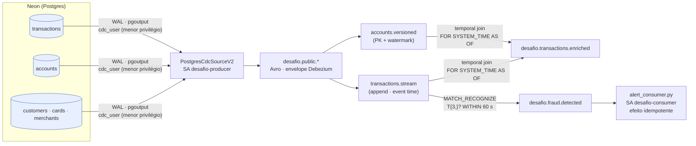

# Pipeline de pagamentos em tempo real — Neon → CDC → Flink SQL → alerta

Pipeline de streaming de ponta a ponta no **Confluent Cloud**: as transações nascem num Postgres (Neon), entram no Kafka por **CDC (Debezium)** como eventos Avro com contrato no Schema Registry, são **enriquecidas** com a conta vigente por um *temporal join* no **Flink SQL** e passam por uma **regra de fraude** (3 transações no mesmo cartão em 60 s). O alerta chega a um consumidor que aplica o efeito de forma **idempotente**.

Tudo sobe com `./setup.sh` e desce com `./teardown.sh`. Cada camada abaixo traz o que faz, por que foi escolhida assim e a evidência de que rodou.



| Peça | Escolha | Por quê |
|---|---|---|
| Origem | Neon (Postgres serverless) | Postgres real com replicação lógica gerenciada e plano gratuito. |
| Ingestão | CDC (Debezium `PostgresCdcSourceV2`) e não batch | Captura cada INSERT/UPDATE/DELETE do WAL em segundos, sem consultar a tabela nem perder estados intermediários. Fraude em tempo real não espera o próximo lote. |
| Formato | Avro + Schema Registry | Contrato tipado e versionado; `numeric(15,2)` vira `bytes`+`decimal(15,2)` sem perder centavos para ponto flutuante. |
| Processamento | Flink SQL gerenciado | Join temporal e detecção de padrão (CEP) declarativos, com estado e event time, sem operar cluster. |
| Saída | Tópicos + consumidor Python | O tópico desacopla quem detecta de quem age; o consumidor mostra onde mora a idempotência. |

---

## Como subir do zero

**Pré-requisitos (uma vez)**

1. Conta no [Confluent Cloud](https://confluent.cloud) e a [Confluent CLI](https://docs.confluent.io/confluent-cli/current/install.html) v4+; faça `confluent login --save` com a sua conta.
2. Projeto no [Neon](https://neon.tech) com **Postgres 16** (evite 17.5, que tem um bug de logical decoding). Em *Settings → Logical Replication*, clique **Enable** (reinicia o compute e não volta atrás).
3. Na máquina: `bash`, `jq`, `psql`, `curl` e `python3` (este último para formatar evidências e rodar o consumidor: `pip install -r consumer/requirements.txt`).

**Subindo**

```bash
git clone https://github.com/<seu-usuario>/desafio-pipeline-pagamentos.git
cd desafio-pipeline-pagamentos
cp .env.example .env        # preencha host/usuário/senha do Neon e a senha do cdc_user
./setup.sh                  # ~15 min: camadas 1 → 4, gerando evidencias/
./scripts/disparar-fraude.sh            # prova da camada 4
./scripts/consumir-alertas.sh           # em outro terminal: o consumidor idempotente
./scripts/05-operacao.sh                # camada 5 (rode ~10 min depois: métricas atrasam)
./scripts/checar-entrega.sh             # checklist antes de submeter
```

Use o host **direto** do Neon (sem `-pooler`): replicação lógica não passa pelo PgBouncer.

Os scripts são idempotentes: IDs e chaves criados ficam em `.state.env` (gitignored) e uma nova execução reaproveita o que já existe. Cada camada também roda sozinha (`./scripts/0N-*.sh`).

**Derrubando**

```bash
./teardown.sh
```

Remove, nesta ordem: statements e compute pool do Flink, conector, **slot de replicação e publication no Neon** (um slot órfão retém WAL indefinidamente), API keys, cluster, environment e service accounts. Antes de apagar o cluster, grava a prova de que não sobrou nada cobrando em `evidencias/99-teardown.txt`.

### Estrutura

```
connectors/cdc.json      config do conector, sem segredos (placeholders ${VAR} preenchidos do .env em tempo de execução)
db/                      DDL, seed determinístico (seed=42), cdc_user + publication, scripts de demo
schemas/                 contratos Avro (namespace com.bootcamp.payments.*) e variações para o teste de evolução
sql/                     statements Flink SQL, executados em ordem pelo nome
scripts/                 uma etapa por camada + demos + coleta de evidências
consumer/                consumidor de alertas com efeito idempotente
evidencias/              saídas reais capturadas pelos scripts
```

---

## Camada 1 — Fundação

**O que faz:** cria o environment `desafio-final` (Stream Governance *Essentials*, que traz o Schema Registry), o cluster **Basic** `desafio-basic` em `aws/us-east-1` e as identidades.

| Service account | Para quê | Acesso |
|---|---|---|
| `desafio-producer` | principal do conector CDC | ACL `CREATE, WRITE, DESCRIBE` em tópicos com prefixo `desafio` e `__debezium-heartbeat`; `DESCRIBE` no cluster; `DeveloperRead/Write` em subjects `desafio*` |
| `desafio-consumer` | consumidor de alertas e leitura das evidências | ACL `READ, DESCRIBE` em tópicos `desafio*` + `READ` em grupos `desafio*`; `DeveloperRead` em subjects `desafio*` |
| `desafio-flink` | principal dos statements Flink | `EnvironmentAdmin` **só** no environment do desafio |
| `desafio-ops` | Metrics API | `MetricsViewer` (somente leitura de métricas) |

A conta pessoal só aparece no setup e no teardown: cria recursos, registra os contratos e lê o billing. Nada que roda continuamente usa a conta pessoal.

**Por quê:** separar quem escreve de quem lê limita o estrago de uma chave vazada. A chave do consumidor não escreve em nada, e o conector não lê nada além do que publica. O `desafio-flink` tem o papel mais amplo; isso é um trade-off consciente: o Flink precisa criar tópicos e subjects e ler/escrever em vários deles, e o escopo fica preso a um environment descartável. Em produção, eu trocaria por `ResourceOwner` em prefixos específicos.

**Evidência** — `evidencias/01-fundacao-identidades.txt`

```text
$ confluent iam service-account list
  Current |     ID     |       Name       |          Description
----------+------------+------------------+---------------------------------
          | sa-196n725 | desafio-ops      | Somente leitura de metricas
          | sa-dgp1doo | desafio-flink    | Principal dos statements Flink
          | sa-j879dom | desafio-producer | Escreve em desafio*: usado
          | sa-ygw6pq7 | desafio-consumer | Le de desafio* e usa grupos

$ confluent kafka acl list --service-account sa-j879dom
     Principal    | Permission | Operation | Resource Type |    Resource Name     | Pattern Type
------------------+------------+-----------+---------------+----------------------+---------------
  User:sa-j879dom | ALLOW      | CREATE    | TOPIC         | __debezium-heartbeat | PREFIXED
  User:sa-j879dom | ALLOW      | CREATE    | TOPIC         | desafio              | PREFIXED
  User:sa-j879dom | ALLOW      | DESCRIBE  | CLUSTER       | kafka-cluster        | LITERAL
  User:sa-j879dom | ALLOW      | DESCRIBE  | TOPIC         | __debezium-heartbeat | PREFIXED
  User:sa-j879dom | ALLOW      | DESCRIBE  | TOPIC         | desafio              | PREFIXED
  User:sa-j879dom | ALLOW      | WRITE     | TOPIC         | __debezium-heartbeat | PREFIXED
  User:sa-j879dom | ALLOW      | WRITE     | TOPIC         | desafio              | PREFIXED

$ confluent kafka acl list --service-account sa-ygw6pq7
     Principal    | Permission | Operation | Resource Type | Resource Name | Pattern Type
------------------+------------+-----------+---------------+---------------+---------------
  User:sa-ygw6pq7 | ALLOW      | DESCRIBE  | TOPIC         | desafio       | PREFIXED
  User:sa-ygw6pq7 | ALLOW      | READ      | GROUP         | desafio       | PREFIXED
  User:sa-ygw6pq7 | ALLOW      | READ      | TOPIC         | desafio       | PREFIXED
```

## Camada 2 — Contrato de dados

**O que faz:** registra os contratos dos tópicos de saída em `schemas/`, com namespace `com.bootcamp.payments.*`, dinheiro como `bytes` + `decimal(15,2)` e tags nos campos sensíveis (`holder_name` → **PII**, `card_last4` → **PCI**). Os subjects ficam em compatibilidade **BACKWARD**. Os tópicos de origem (`desafio.public.*`) têm schema registrado pelo próprio conector a partir das colunas do Postgres.

**Por quê BACKWARD:** é o modo que permite atualizar **primeiro os consumidores** e reler o histórico do tópico com o schema novo. Em streaming, o consumidor de alertas precisa conseguir ler mensagens antigas depois de um deploy.

**Teste de evolução, nos dois sentidos**

| Mudança proposta | Resultado em BACKWARD | Por quê |
|---|---|---|
| v2: novo campo `risk_score` **com** `default: null` | ✅ compatível | Leitor novo lendo dado antigo usa o default. |
| v3: novo campo `analyst_id` **sem** default | ❌ rejeitado | Leitor novo não tem de onde tirar o valor nas mensagens antigas. |
| v4: **remove** o campo obrigatório `card_last4` | ✅ compatível em BACKWARD · ❌ rejeitado em FORWARD | Leitor novo só ignora o campo. Quem quebra é o leitor **antigo**, que exige o campo — isso é o que FORWARD protege. |

O modelo do desafio fala em "rejeitar remoção de campo obrigatório", mas em Avro com BACKWARD essa remoção é aceita: a rejeição clássica de BACKWARD é **adicionar campo sem default**. Por isso o script testa os três casos e faz a contraprova da remoção sob FORWARD num subject descartável.

**Evidência** — `evidencias/02-contrato-evolucao.txt`

```text
# Subject: desafio.fraud.detected-value | compatibilidade: BACKWARD

## Versão registrada
{
  "subject": "desafio.fraud.detected-value",
  "version": 1,
  "id": 100001
}

## POST /compatibility/subjects/desafio.fraud.detected-value/versions/latest  <- fraud_alert_v2_campo_novo_com_default.avsc
{
  "is_compatible": true,
  "messages": []
}

## POST /compatibility/subjects/desafio.fraud.detected-value/versions/latest  <- fraud_alert_v3_campo_novo_sem_default.avsc
{
  "is_compatible": false,
  "messages": [
    "{errorType:\"READER_FIELD_MISSING_DEFAULT_VALUE\", description:\"The field 'analyst_id' at path '/fields/11' in the new schema has no default value and is missing in the old schema\", additionalInfo:\"analyst_id\"}",
    "{oldSchemaVersion: 1}",
    "{oldSchema: …schema v1 completo omitido…}",
    "{validateFields: 'true', compatibility: 'BACKWARD'}"
  ]
}

## POST /compatibility/subjects/desafio.fraud.detected-value/versions/latest  <- fraud_alert_v4_remove_campo_obrigatorio.avsc
{
  "is_compatible": true,
  "messages": []
}

## Contraprova — subject desafio.contrato-forward-demo-value com FORWARD <- fraud_alert_v4_remove_campo_obrigatorio.avsc
{
  "is_compatible": false,
  "messages": [
    "{errorType:\"READER_FIELD_MISSING_DEFAULT_VALUE\", description:\"The field 'card_last4' at path '/fields/3' in the old schema has no default value and is missing in the new schema\", additionalInfo:\"card_last4\"}",
    "{oldSchemaVersion: 1}",
    "{oldSchema: …schema v1 completo omitido…}",
    "{validateFields: 'true', compatibility: 'FORWARD'}"
  ]
}
```

## Camada 3 — Ingestão (CDC)

**O que faz:** cria o modelo (`db/01-schema.sql`), carrega o seed e liga o conector `PostgresCdcSourceV2` (config em [`connectors/cdc.json`](connectors/cdc.json), sem segredos: a senha vem do `.env` no momento do `create` e o arquivo renderizado é apagado logo depois).

Decisões do conector:

- **`cdc_user` com menor privilégio:** só `LOGIN REPLICATION` + `SELECT` nas 5 tabelas. A publication `desafio_pub` é criada pelo dono do banco e o conector roda com `publication.autocreate.mode=disabled`, então não precisa de `CREATE` nem de ser dono das tabelas.
- **`REPLICA IDENTITY FULL`** em todas as tabelas: sem isso, o `before` do UPDATE vem nulo ou só com a PK.
- **`heartbeat.interval.ms=60000`:** mesmo sem mudança nas tabelas capturadas, o conector confirma posição no slot a cada minuto, e o Postgres pode descartar WAL antigo. Sem heartbeat, um banco com escrita em outras tabelas acumula WAL até encher o disco.
- **`decimal.handling.mode=precise`** (decimal exato) e **`time.precision.mode=connect`** (timestamps em milissegundos, que o Flink lê como `TIMESTAMP_LTZ(3)`).
- **`after.state.only=false`:** mantém o envelope completo (`before`, `after`, `op`, `source`) — é ele que prova os três tipos de evento.

Seed determinístico (`db/gerar_seed.py`, `seed=42`): os mesmos dados toda vez, com horários relativos ao momento da carga. O gerador garante que nenhum cartão do seed tenha 3 transações em 60 s, para que o único alerta seja o da demo.

```text
 customers | accounts | cards | merchants | transactions
-----------+----------+-------+-----------+--------------
       200 |      240 |   320 |        60 |         2000
```

(conferido em `evidencias/03-seed-contagem.txt`)

**Os três tipos de evento** — gerados por `db/05-demo-cud.sql` (INSERT → UPDATE → DELETE da mesma transação) e lidos pelo `desafio-consumer`. Envelopes completos em [`evidencias/01-envelopes-cdc.json`](evidencias/01-envelopes-cdc.json):

- `op=c` (INSERT): `before = null`, `after` com a linha nova;
- `op=u` (UPDATE): `before` completo (graças ao `REPLICA IDENTITY FULL`) e `after`;
- `op=d` (DELETE): `after = null`, seguido de um **tombstone** (valor nulo) com a mesma chave, para a compactação poder remover a chave.

```json
[
  {
    "key": "\u0000\u0000\u0001���\u001f",
    "value": {
      "after": {
        "desafio.public.transactions.Value": {
          "account_id": 7,
          "amount": "42",
          "card_id": 7,
          "card_last4": "7157",
          "created_at": "2026-11-11T03:00:40.099Z",
          "currency": "BRL",
          "merchant_id": 1,
          "status": "PENDENTE",
          "transaction_id": 2001
        }
      },
      "before": null,
      "op": "c",
      "source": {
        "connector": "postgresql",
        "db": "neondb",
        "lsn": 30284760,
        "name": "desafio",
        "schema": "public",
        "sequence": "[null,\"30284760\"]",
        "snapshot": "false",
        "table": "transactions",
        "ts_ms": 1794366040111,
        "txId": 4113,
        "version": "3.2.5.Final",
        "xmin": null
      },
      "transaction": null,
      "ts_ms": 1794366040299
    }
  },
  {
    "key": "\u0000\u0000\u0001���\u001f",
    "value": {
      "after": {
        "desafio.public.transactions.Value": {
          "account_id": 7,
          "amount": "87/2",
          "card_id": 7,
          "card_last4": "7157",
          "created_at": "2026-11-11T03:00:40.099Z",
          "currency": "BRL",
          "merchant_id": 1,
          "status": "APROVADA",
          "transaction_id": 2001
        }
      },
      "before": {
        "desafio.public.transactions.Value": {
          "account_id": 7,
          "amount": "42",
          "card_id": 7,
          "card_last4": "7157",
          "created_at": "2026-11-11T03:00:40.099Z",
          "currency": "BRL",
          "merchant_id": 1,
          "status": "PENDENTE",
          "transaction_id": 2001
        }
      },
      "op": "u",
      "source": {
        "connector": "postgresql",
        "db": "neondb",
        "lsn": 30285256,
        "name": "desafio",
        "schema": "public",
        "sequence": "[\"30285256\",\"30285256\"]",
        "snapshot": "false",
        "table": "transactions",
        "ts_ms": 1794366042399,
        "txId": 4114,
        "version": "3.2.5.Final",
        "xmin": null
      },
      "transaction": null,
      "ts_ms": 1794366042828
    }
  },
  {
    "key": "\u0000\u0000\u0001���\u001f",
    "value": {
      "after": null,
      "before": {
        "desafio.public.transactions.Value": {
          "account_id": 7,
          "amount": "87/2",
          "card_id": 7,
          "card_last4": "7157",
          "created_at": "2026-11-11T03:00:40.099Z",
          "currency": "BRL",
          "merchant_id": 1,
          "status": "APROVADA",
          "transaction_id": 2001
        }
      },
      "op": "d",
      "source": {
        "connector": "postgresql",
        "db": "neondb",
        "lsn": 30285504,
        "name": "desafio",
        "schema": "public",
        "sequence": "[\"30285504\",\"30285504\"]",
        "snapshot": "false",
        "table": "transactions",
        "ts_ms": 1794366044685,
        "txId": 4115,
        "version": "3.2.5.Final",
        "xmin": null
      },
      "transaction": null,
      "ts_ms": 1794366044855
    }
  },
  {
    "key": "\u0000\u0000\u0001���\u001f",
    "value": {}
  }
]
```

## Camada 4 — Processamento (Flink SQL)

Statements em [`sql/`](sql/), executados em ordem com `sql.tables.scan.idle-timeout=5s`:

| # | Statement | Papel |
|---|---|---|
| 01–02 | `ALTER TABLE desafio.public.{transactions,accounts}` | lê o envelope Debezium como `avro-registry` + `append` |
| 03–04 | `desafio.accounts.versioned` | tabela **versionada** de contas: `PRIMARY KEY (account_id)` + watermark em `updated_at` |
| 05–06 | `desafio.transactions.stream` | fluxo **append-only** de nascimentos de transação (`op` r/c) com watermark em `created_at` |
| 07 | temporal join → `desafio.transactions.enriched` | transação ⋈ conta vigente **no instante da transação** |
| 08 | `MATCH_RECOGNIZE` → `desafio.fraud.detected` | **RULE_VELOCITY** |

**Temporal join.** `FOR SYSTEM_TIME AS OF t.created_at` pega a versão da conta que valia quando a compra aconteceu, não a de agora. Se o limite da conta mudar depois, a transação antiga continua enriquecida com o limite antigo, e reprocessar dá o mesmo resultado. O lado da conta precisa de PK e watermark. O lado da transação é append-only, e esse é o único desvio do modelo (que pede PK nos dois lados): uma PK em `transactions.stream` transformaria a tabela em upsert, e o `MATCH_RECOGNIZE` só aceita entrada append-only. Uma transação só nasce uma vez, então append é a semântica correta.

**RULE_VELOCITY.**

```sql
PARTITION BY card_id
ORDER BY created_at
PATTERN (T{3,}?) WITHIN INTERVAL '60' SECOND
AFTER MATCH SKIP PAST LAST ROW
```

- `PARTITION BY card_id`: a regra é por cartão.
- `T{3,}?` relutante: fecha o match assim que a 3ª transação chega (o Flink não aceita quantificador guloso na última variável).
- `WITHIN 60 s` em **event time**: conta a hora da compra, não a de chegada no Kafka.
- `SKIP PAST LAST ROW`: a mesma transação não gera dois alertas.
- `alert_id = RULE_VELOCITY-<card_id>-<1ª transação>` é determinístico: um reprocessamento gera o **mesmo** id, e o consumidor deduplica por ele.

**Por que `idle-timeout=5s` e a 4ª transação da demo.** Num join temporal o resultado só sai quando o watermark dos dois lados passa do instante da transação. Contas mudam pouco, então esse lado fica parado e seguraria o watermark para sempre; o idle-timeout tira a partição parada do cálculo. Pelo mesmo motivo, o `MATCH_RECOGNIZE` só emite quando o watermark passa da 3ª transação. Por isso `db/06-burst-fraude.sql` insere, 15 s depois, uma transação de outro cartão, que só empurra o watermark.

**Evidência** — `./scripts/disparar-fraude.sh` → `evidencias/04-alerta-fraude.txt`

```text
# Transações que dispararam o alerta (Postgres, mesmo card_id, < 60 s)
INSERT 0 1
INSERT 0 1
INSERT 0 1
INSERT 0 1
 transaction_id | card_id | card_last4 | amount  |       created_at
----------------+---------+------------+---------+-------------------------
           2002 |      42 | 3367       |  129.90 | 2026-11-11 03:10:30.936
           2003 |      42 | 3367       |  349.00 | 2026-11-11 03:10:36.256
           2004 |      42 | 3367       | 1899.99 | 2026-11-11 03:10:41.581
(3 rows)

# Alerta emitido em desafio.fraud.detected (lido pelo desafio-consumer)
null | {"alert_id":"RULE_VELOCITY-42-2002","card_id":42,"card_last4":"3367","detected_at":"2026-11-11T03:11:21.879Z","first_transaction_id":2002,"last_transaction_id":2004,"rule_name":"RULE_VELOCITY","total_amount":"237889/100","tx_count":3,"window_end":"2026-11-11T03:10:41.581Z","window_start":"2026-11-11T03:10:30.936Z"}

# As mesmas transações já enriquecidas com a conta (desafio.transactions.enriched)
null | {"account_id":42,"account_status":"ATIVA","account_type":"POUPANCA","account_version_at":"2026-08-29T05:12:03.877Z","amount":"1299/10","card_id":42,"card_last4":"3367","created_at":"2026-11-11T03:10:30.936Z","credit_limit":"500","currency":"BRL","customer_id":42,"holder_name":"Paulo Silva","merchant_id":11,"transaction_id":2002,"tx_status":"APROVADA"}
null | {"account_id":42,"account_status":"ATIVA","account_type":"POUPANCA","account_version_at":"2026-08-29T05:12:03.877Z","amount":"349","card_id":42,"card_last4":"3367","created_at":"2026-11-11T03:10:36.256Z","credit_limit":"500","currency":"BRL","customer_id":42,"holder_name":"Paulo Silva","merchant_id":23,"transaction_id":2003,"tx_status":"APROVADA"}
null | {"account_id":42,"account_status":"ATIVA","account_type":"POUPANCA","account_version_at":"2026-08-29T05:12:03.877Z","amount":"189999/100","card_id":42,"card_last4":"3367","created_at":"2026-11-11T03:10:41.581Z","credit_limit":"500","currency":"BRL","customer_id":42,"holder_name":"Paulo Silva","merchant_id":37,"transaction_id":2004,"tx_status":"APROVADA"}
```

**Se o alerta não aparecer:** confira se os 8 statements estão `RUNNING`/`COMPLETED` (`evidencias/04-statements.txt`) e se `desafio.transactions.stream` recebeu as transações. O motivo mais comum é watermark parado: rode o burst de novo ou insira qualquer outra transação.

## Camada 5 — Operação: as quatro respostas

`./scripts/05-operacao.sh` mede e grava cada resposta em `evidencias/05-*.txt`.

| Pilar | Resposta (medida) |
|---|---|
| ① Observabilidade | Pico de `received_bytes`: **463 KB/min** em 2026-11-11T02:59:00Z — o snapshot inicial do CDC (2.000 transações + cadastros de uma vez); total na janela: 610 KB. Consumer lag (mensagens): `desafio-alertas` último 1 / máx 1; `desafio-replay` último 1 / máx 1 — o consumidor acompanhou em tempo real. |
| ② Segurança | tabela abaixo |
| ③ Custos | Ambiente de teste com créditos gratuitos do Confluent Cloud; total do período em **Custo total** abaixo (`confluent billing cost list`). Alavancas abaixo. |
| ④ Confiabilidade | tabela abaixo |

**② Segurança — SA → acesso → porquê**

| SA | Acesso | Porquê |
|---|---|---|
| `desafio-producer` | escreve/cria `desafio*` e heartbeat; SR write | o conector só publica; não lê nenhum tópico |
| `desafio-consumer` | lê `desafio*`, grupos `desafio*`; SR read | leitor não escreve: chave vazada não injeta alerta falso |
| `desafio-flink` | EnvironmentAdmin do environment do desafio | cria tabelas/tópicos/subjects; escopo limitado a um environment descartável |
| `desafio-ops` | MetricsViewer | observabilidade sem acesso a dados |
| `cdc_user` (Postgres) | `REPLICATION` + `SELECT` em 5 tabelas | não escreve, não é dono, não cria publication |

Segredos: `.env` e `.state.env` no `.gitignore`; o conector recebe a senha só no momento da criação; `./scripts/checar-entrega.sh` falha se algo com cara de segredo estiver versionado.

**③ Custos — duas alavancas**

1. **Desligar o que cobra por hora quando não está em uso.** Conector (hora de task) e Flink (CFU-minuto) são o grosso do custo; o teardown remove os dois primeiro. Para pausar sem destruir: `confluent connect cluster pause` e parar os statements.
2. **Teto e dimensionamento.** Compute pool com `--max-cfu 5` (teto de gasto do Flink), tópicos com 1 partição e cluster Basic, sem custo fixo por hora. O volume da demo cabe folgado.

**④ Confiabilidade — trecho a trecho**

| Trecho | Garantia | Como |
|---|---|---|
| Postgres → conector | sem perda | slot de replicação guarda o WAL até o conector confirmar; heartbeat evita WAL acumulado |
| Conector → Kafka | at-least-once (pode duplicar em restart) | offsets do Connect; replicação 3× no Confluent Cloud |
| Kafka → Flink → Kafka | exactly-once dentro do Flink | checkpoints + escrita transacional gerenciados pelo Confluent Cloud |
| **Kafka → consumidor → efeito** | **elo fraco: at-least-once** | **a idempotência é código meu:** `INSERT OR IGNORE` por `alert_id` e commit manual do offset só depois do efeito (`consumer/alert_consumer.py`) |

Prova da idempotência: rode `ALERT_GROUP=desafio-replay ./scripts/consumir-alertas.sh` — o grupo novo relê o tópico do início e cada alerta aparece como `DUPLICADO — ignorado`.

```text
$ ./scripts/consumir-alertas.sh
ouvindo desafio.fraud.detected como grupo desafio-alertas (Ctrl+C para sair)
[p0@0] RULE_VELOCITY-42-2002 cartão *3367 3 tx R$ 2378.89 -> EFEITO APLICADO

$ ALERT_GROUP=desafio-replay ./scripts/consumir-alertas.sh   # grupo novo relê o tópico do início
ouvindo desafio.fraud.detected como grupo desafio-replay (Ctrl+C para sair)
[p0@0] RULE_VELOCITY-42-2002 cartão *3367 3 tx R$ 2378.89 -> DUPLICADO — ignorado (idempotência)
```

## Custo total e teardown

**Custo declarado:** **US$ 1.84** — total do período em `confluent billing cost list`, pago com os créditos de teste do Confluent Cloud (nenhum valor cobrado em cartão). Neon no plano gratuito: US$ 0,00.

`./teardown.sh` executado ao final — verificação de listas vazias:

```text
$ confluent connect cluster list
None found.

$ confluent flink statement list
None found.

$ psql -c 'SELECT slot_name FROM pg_replication_slots'
     slot_name      | active
--------------------+--------
 wal_proposer_slot  | t
 wal_retention_slot | f
(2 rows)


$ confluent environment list | grep desafio-final
(nenhum environment desafio-final)
```

---

## Ideias para evoluir

- Segunda regra de fraude: valor acima de 80% do `credit_limit` da versão da conta (usa o tópico enriquecido) ou cartão em duas cidades em 10 min.
- DLQ: `errors.tolerance=all` no conector e uma tabela de rejeitos no Flink para eventos com defeito.
- Tableflow: materializar `desafio.transactions.enriched` como tabela Apache Iceberg.
- Score de risco por modelo de IA preenchendo o campo `risk_score` (já previsto na v2 do contrato).
